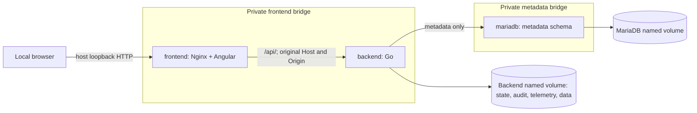

# ADR-0006: Local Compose deployment and MariaDB metadata

## Status

Accepted by explicit user direction on 2026-11-18. Implemented as a local
Compose profile; this is not a production/remote service.
It supplements [ADR-0002](./ADR-0002-local-reference-profile.md) and changes
the GUI deployment choice in [ADR-0005](./ADR-0005-local-gui-and-http-endpoint-boundary.md).

## Context

The CLI and standalone HTTP API preserve their local file use cases. The
explicit container profile adds Angular/Nginx, a Go HTTP backend, and MariaDB
metadata persistence without making SQL a core-domain dependency.
`ports.MetadataRepository` and `ports.MetadataValidationStore` retain file
implementations; `local.Discover` uses an application-owned proposal port.
The container profile keeps metadata, execution state, audit and data as
separate authorities (`docs/operations/local-reference.md`).

## Decision

- Use Docker Compose with exactly three runtime services: `frontend`,
  `backend`, and `mariadb`. Use separate private bridge networks for frontend
  to backend and backend to MariaDB, so the frontend cannot connect directly
  to the database. Publish only the frontend HTTP port to the host, bound to
  host loopback. Do not publish backend or MariaDB ports. The bridges and
  unpublished ports are exposure controls, not authentication or protection
  against a privileged host or other network members.
- Serve the Angular static application with Nginx in `frontend`. Proxy
  `/api/` to the Go `backend`, preserving the original browser `Host`
  (including port), `Origin`, and request path. The browser uses relative
  same-origin URLs; do not enable CORS. Backend mutation guards must still
  require a valid HTTP Origin whose host equals the preserved request Host
  and is `localhost` or a loopback IP. Do not trust client-supplied forwarded
  host/origin headers to decide this. Test forged, missing and mismatched
  origins and non-loopback hosts through the proxy.
- Default standalone HTTP behavior remains loopback-only. Only an explicit
  container-network mode may bind the backend to `0.0.0.0`; it remains
  unpublished. The mode retains `--allow-local`, the local-user grant,
  request bounds, same-origin guard and other ADR-0005 controls. It is not
  hosted identity or multi-user authorization.
- MariaDB owns a database/schema named `metadata`; only the backend connects
  to it. Require credentials supplied via environment or a local `.env` that
  must be ignored by version control; do not supply committed credentials or
  insecure defaults. The current `.gitignore` does not yet ignore `.env`:
  implementation must add that protection before introducing it. Use a
  least-privilege application account limited to the metadata database;
  provisioning/migration privileges must not be used by ordinary requests.
  Metadata stores secret references, never secret values. Redact credentials,
  records, and sensitive metadata from logs, errors and telemetry.
- Give MariaDB a named persistent volume and a healthcheck. Backend startup
  must wait/reconnect for actual database readiness, and handle later
  disconnects with bounded, observable failures; Compose startup ordering
  alone is insufficient. Do not blindly retry writes with uncertain commit
  outcomes. Surface readiness separately from the existing static profile
  health check.
- Mount the host `./data/sources` directory read-only at `/data/sources` in
  the backend container. Container API operations that require a source root
  reject roots outside this mount; no arbitrary host path or volume is exposed
  through the API. The backend root filesystem is read-only except for a
  bounded temporary filesystem, and its separate named state volume is
  writable.
- The database is the sole metadata authority in this container profile:
  drafts, immutable revisions, active pointer and activation history,
  validation reports, and discovery proposals. Preserve validation before
  activation, immutable identity/digests, conditional activation and conflict
  behavior; update active pointer and history atomically. Discovery remains
  advisory, never activates metadata, and does not add a proposal-query API.
  Retain revisions needed for provenance and pinned replay; schema drift
  requires explicit review and activation.
- Implement MariaDB persistence as an infrastructure SQL adapter behind
  `MetadataRepository` and `MetadataValidationStore`; introduce an
  application-owned proposal persistence port and route discovery through
  it. Refactor current concrete file composition as necessary, without
  importing SQL into domain contracts or moving policy into adapters.
  Preserve the existing local file profile for CLI and existing tests.
- Keep plans, schedule requests, execution state/checkpoints, audit,
  telemetry, destination, quarantine and cleaned data outside MariaDB in a
  separate named backend volume, using their existing logical separation.
  Quality detection remains separate from explicit, auditable cleaning.
  No cross-store atomic transaction is assumed: preserve required audit and
  reconciliation semantics, including uncertain commits and checkpoint-after-
  destination-commit ordering.
- Back up and restore both volumes consistently with the application stopped;
  preserve both authorities, verify restored revision references, and do not
  imply an atomic live cross-volume snapshot. File-profile data is not silently
  migrated. Any import, schema migration, compatibility and rollback procedure
  needs explicit tests and documentation before use.

## Alternatives considered

- Go-served Angular assets: appropriate to the earlier standalone decision but
  replaced for this explicitly requested container profile.
- Direct browser access to the backend or CORS: rejected to retain one browser
  origin and avoid publishing another port.
- Metadata in files inside the backend volume: retained for the CLI profile,
  but not for this container profile because MariaDB is its metadata authority.
- Combining execution data and metadata in MariaDB: rejected to preserve
  distinct data, state and metadata authorities.

## Consequences

The implementation uses Go 1.27.4, Angular 22, MariaDB 11.4, Nginx, and
embedded ordered SQL migrations applied at backend startup with a separate
schema-scoped migration credential. The runtime account has only metadata
`SELECT`, `INSERT`, and `UPDATE` privileges. Backup and restore remain manual:
stop the application and preserve both volumes as one offline backup set.
There is no automatic file-profile migration. The Angular app currently
provides profile identity and API connectivity; full operation journeys remain
in BL-023.4–.6. This implementation does not claim production readiness,
automated backup, or verified restore drills.

## Owner and affected backlog

Decision authority: the user. BL-023 owner tracks implementation in
[BL-023](../../backlog/BL-023-gui-local-profile.md); BL-022's general external
adapter deferral remains except for this concrete local metadata adapter.
