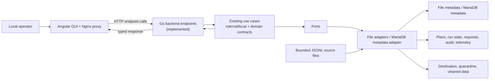

# GUI Architecture for the Local Reference Profile

## Status and scope

**The Go HTTP backend, OpenAPI contract, Angular connectivity shell, Nginx
proxy, Compose profile, and MariaDB metadata adapter are implemented.** The
Angular browser application is served by Nginx and proxies the API same-origin
in the three-container profile in
[ADR-0006](./decisions/ADR-0006-local-compose-and-metadata-persistence.md).
The backend exposes synchronous HTTP/JSON endpoints under `/api/v1`, described
by OpenAPI 3.1. The implemented standalone process is loopback-only and starts
only with explicit `--allow-local`; the explicit container-network mode retains
the grant, restricts sources to the read-only `/data/sources` mount, and listens
on the private container network. The current Angular UI is a connectivity
shell, not the complete set of operation journeys. See
[ADR-0005](./decisions/ADR-0005-local-gui-and-http-endpoint-boundary.md) for
the accepted boundary. This document describes how the GUI can cover
existing local-reference capabilities without adding domain behavior or
claiming a hosted service. The CLI remains available and unchanged
(`cmd/mimir/main.go`).

The scope is limited to the commands and behaviors in
`cmd/mimir/main.go`, `internal/local/`, and
`docs/user/local-reference-ingestion.md`. Product goals elsewhere in the
README, including general-purpose discovery, streaming, external adapters,
and production governance, are not implemented GUI capabilities.

## Boundary and responsibility

The GUI is a presentation adapter. It may collect inputs, display validated
results, and request explicit operations, but it does not own metadata policy,
authorization, run state, durable data, schedule decisions, or cleaning
semantics. Those remain with the existing domain/use-case code and ports
described in the [software architecture](./software-architecture.md).

The diagram includes the container profile as well as the standalone CLI/API
profile. The backend translates versioned typed requests into existing local
use cases. In Compose, MariaDB owns drafts, revisions, active metadata,
validation reports, and discovery proposals; execution state and data remain
on the separate backend volume.
The endpoint contract is
[`contracts/openapi/local-profile-v1.json`](../../contracts/openapi/local-profile-v1.json).
The GUI must not duplicate validation, planning, access checks, state
transitions, or adapter behavior, and must not treat the local journals as a
UI database. The accepted process and protocol boundary is in ADR-0005.

The CLI currently returns JSON on standard output and failures on standard
error (`execute` and `writeJSON` in `cmd/mimir/main.go`). That CLI encoding is
not, by itself, an endpoint contract. The backend uses synchronous HTTP/JSON
under `/api/v1` with OpenAPI 3.1, explicit request/result DTOs, and the
`mimir.failure/v1` error envelope with the HTTP mappings in ADR-0005.

## Implemented capability-to-surface map

The journeys below are mappings of existing use cases, not promises of current
GUI pages. Operations guarded by the local profile retain the explicit
`--allow-local` gate; validation and validation-report lookup retain their
current behavior, including optional local report persistence without that
grant flag. A GUI must not silently bypass or reinterpret a use-case guard.

| GUI journey / surface | Implemented operation and result | Important limit |
| --- | --- | --- |
| Profile status | `health`: reports binary/contract identity and the built-in `local-reference-v1` capability registration. | `local.CheckProfile` does not check filesystem, source, destination, or environment readiness; do not show it as an end-to-end readiness check. |
| Validate metadata | `validate` returns deterministic diagnostics. The CLI currently reads a metadata JSON file; the HTTP API will accept bounded inline JSON. With a private state directory it persists the immutable report; `validation-report` retrieves it by exact input digest. | Reports are never run-eligible. Strict metadata v1 JSON is required; invalid input must remain visibly invalid. |
| Author and review revisions | `author` stores a validated immutable draft; `list-metadata` lists revision, status, and digest; `activate` activates a candidate or stored draft. | Listing does not return full revision contents or history details. Activation is an explicit action; replacing the active revision uses `expected-active` to prevent stale replacement. |
| Discover schema proposal | `discover` observes the active local JSONL object and returns normalized schema observations and a proposal. | Discovery is bounded to the local JSONL profile and does not change active metadata. No proposal-list/retrieval UI query is implemented; the immediate result is the available response. |
| Run ingestion | `run` reads one bounded local JSONL source snapshot against the active revision and returns run ID, metadata revision, record count, and whether the batch was already committed. | One source object, at most 16 MiB and 1,000 records. The result is not a run-history, record-browsing, or per-record quality-results API. Transformation, quality disposition, quarantine, and durable recovery follow the active metadata and existing use case. |
| Evaluate and stop schedule requests | `schedule` evaluates fixed interval slots and returns decisions and stable requests. `schedule-stop` acknowledges all pending local requests with `cancelled` or `shutdown`. | Evaluation stores requests but never dispatches or starts runs. Stopping requests does not alter run state; no dispatcher or stopped-request resume exists. |
| Prepare replay/reconcile | `replay` accepts an original run ID and reason, verifies pinned metadata, source digest, adapter capabilities, and rules, then reconciles the original idempotent batch. | This is not a new output-producing replay or arbitrary historical replay. It requires the unchanged source snapshot and compatible active metadata. |
| Preview/apply cleaning | `clean` accepts one JSON-object record, explicit `public`/`internal` classification, correction identity/version and supported operation; the CLI currently reads the record from a file, while the HTTP API will accept bounded inline JSON. Preview is non-persistent; apply writes separate cleaned output and audit evidence. | Cleaning never replaces input. Only `trim`, `lowercase`, `uppercase`, or `replace_null` are supported here. The result includes record content and must be treated as sensitive local data. |

The local metadata v1 contract also supports only its implemented transformation
and quality catalogs: transformations are `trim`, `lowercase`, `uppercase`,
`rename`, `to_integer`, and explicit `replace_null`; quality rules are
`required`, `type`, `min`, `max`, and `enum`. Quality dispositions include
`warning`, `reject`, and `quarantine`; `hold` and `cleaning_required` fail
closed in this profile. A GUI must expose the same contract limits and must
not imply broader rule engines or silent correction.

## User journeys and state/data flow

### Metadata through an ingestion run

1. Configure the fixed local state directory when starting the backend. Supply
   a bounded metadata v1 JSON document inline to the relevant operation.
2. Validate it and present safe diagnostics and the input digest. If retaining
   the report, use the selected profile's validation-report store and allow
   retrieval only by that digest.
3. Author the valid draft, then list revisions to confirm its immutable ID,
   status, and digest.
4. Optionally discover the active local object. Present its proposal as
   advisory; require the operator to author a changed draft and explicitly
   activate it before it can affect new runs.
5. Activate a selected draft. If superseding an active revision, require the
   expected current revision; display the resulting active revision and digest.
6. Supply the source root explicitly for discovery, replay, or a run that
   requires it. Request one run and present the returned run ID, pinned
   metadata revision, count, and reconciliation indicator. Do not
   infer success from a schedule request or from `health`.

The existing flow reads a bounded source snapshot, plans against activated
metadata, applies pinned transformation and quality rules, then commits the
destination/quarantine evidence before checkpoint and required audit. The
GUI displays the use-case result; it does not manage those transitions or
write to the destination or state files. Source values are not part of the
ordinary run result.

### Schedule and replay

The operator may evaluate enabled fixed-interval schedules at the current time
or a specified evaluation time. Show returned decisions and request identities
as requests only. A separate, explicit stop action acknowledges pending
requests; label it as stopping requests, not cancelling runs. Replay is a
separate operator-requested action against an existing run identity, with a
required reason and the replay limitations in the table above.

### Cleaning

Submit one bounded JSON-object record inline, explicitly classify it as
`public` or `internal`, and specify a correction ID, version, field, and
supported operation. Show a
preview before any apply action. Applying creates a separate cleaned record
and redacted audit evidence; the UI must make this distinct from validation,
quality detection, and the original record. Do not describe correction as
automatic or as a way to make rejected ingestion succeed.

### Queries and status not currently available

The implemented local interface has no query operation for run history,
individual run state/checkpoints, per-record quality results, audit events,
telemetry, destination records, quarantine contents, cleaned-output history,
or persisted discovery proposals. Metadata listing returns identities only.
A GUI can show results returned by an operation during that interaction, but
must not present unavailable histories, details, or data as if backed by
existing use cases. Adding such queries requires explicit application
contracts and access/data handling decisions.

## Operational and security constraints

- The local profile is one process per private state directory. A GUI must
  preserve exclusive ownership/locking behavior and surface busy, corrupt, or
  ambiguous state as an error requiring the documented recovery process; it
  must not edit or repair journals itself.
- The operator owns the local source, storage, backup, retention, and
  deletion. The file profile's state directory contains separate metadata,
  execution-state, audit/telemetry, destination, quarantine, and cleaned-data
  authorities. In the container profile MariaDB owns metadata drafts,
  revisions, active state, validation reports, and discovery proposals;
  a separate backend volume holds the remaining authorities (ADR-0006).
  Destination, quarantine, and cleaned files can contain record values.
- The local policy permits only explicitly classified `public` and `internal`
  data. This and the current `local-user` / `allow-local` gate are local-use
  controls, not hosted identity, multi-user authorization, or production
  access control. UI visibility is not an authorization boundary; the
  application use case must continue to enforce policy.
- The implemented standalone backend binds to loopback only (default
  `127.0.0.1`) and rejects non-loopback listen addresses. The explicit
  container-network mode binds `0.0.0.0` without publishing the backend port.
  Both require `--allow-local` at startup. It
  passes the existing `local-user` / allow-local grant to protected use cases.
  This is not hosted identity or multi-user authorization and is not safe for
  shared-host exposure. The API has no CORS or remote origins; mutating browser
  requests require same-origin checks, including loopback host validation
  against the original Host and Origin preserved by the container proxy.
- State directory is fixed at server startup. Source roots are supplied
  explicitly to operations that need them. Metadata and cleaning document
  inputs are bounded inline JSON, not arbitrary server file paths. API
  requests enforce JSON content-type and operation-specific body-size limits;
  HTTP cancellation and deadlines propagate through request context.
- Secret values must never be collected into GUI metadata, stored in the
  state directory, or included in plans, logs, audit, telemetry, or errors.
  Local file adapters reject credential references they cannot consume.
- Keep error displays redacted and structured around safe failure category,
  operation/stage, retryability, and commit uncertainty. Do not log full
  metadata, record values, secret references, or raw adapter errors. Cleaning
  preview/result is an explicit exception that contains record content and
  requires local handling according to classification.
- Audit evidence is durable and required for the operations documented by the
  local profile; local telemetry is best-effort and redacted. Metrics/traces
  exporters, remote telemetry, hosted identity, encryption-at-rest, automated
  backup, and production retention are not implemented.

Relevant implementation evidence: command dispatch and JSON output are in
`cmd/mimir/main.go`; metadata use cases in `internal/local/metadata.go` and
`internal/local/validation_store.go`; discovery in
`internal/local/discovery.go`; run semantics in `internal/local/run.go`;
schedule request behavior in `internal/local/scheduler.go`; replay in
`internal/local/replay.go`; cleaning in `internal/local/cleaning.go`; local
capability limits in `internal/local/profile.go`; local storage and recovery
constraints in `docs/operations/local-reference.md` and
`docs/user/local-reference-ingestion.md`; HTTP handlers in `internal/httpapi/`;
the MariaDB adapter in `internal/adapters/mariadb/`; and container composition
in `docker-compose.yml`, `deploy/`, and `frontend/`.

## Remaining GUI journeys

The local server, `/api/v1` operation contract, input limits, cancellation
propagation, same-origin checks, stable failure mapping, explicit container
listener, SQL metadata adapter and proposal port, Angular/Nginx integration,
and Compose profile are implemented under ADR-0005/6 and BL-023.8–.10. Full
Angular operation journeys remain tracked in BL-023.4–.6. Additional query or
domain capabilities remain out of scope and require separate use-case and
security decisions.
