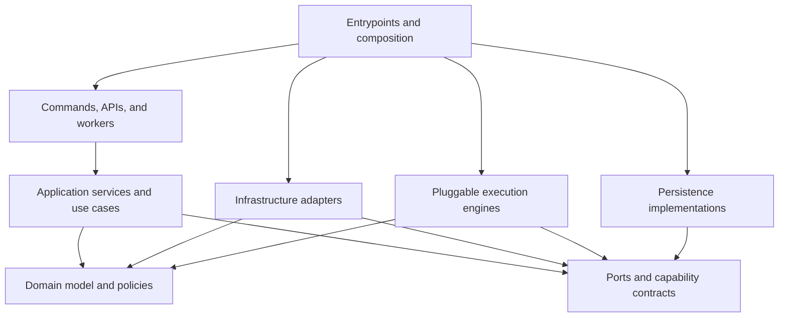

# Mimir Software Architecture

## Status

**Accepted initial software structure for the
[system architecture](./system-architecture.md), with Go module and local
reference-profile decisions recorded in [ADR-0001](./decisions/ADR-0001-foundation-and-contracts.md)
and [ADR-0002](./decisions/ADR-0002-local-reference-profile.md).** The current
implementation is a partial local reference; acceptance of the structure does
not imply that every listed module or port is implemented.

The current local slice implements strict metadata authoring/activation through
a file repository, local-file discovery proposals through a provider port,
immutable plans, fixed-clock schedule requests, a bounded JSONL run with pinned
`v1` transformation and quality rules, quarantine, separate explicit cleaning,
replay preparation, local source/destination adapters, a fenced local run-state
store, append-only audit, and redacted correlated local telemetry. Deterministic
fault injection covers the local durable boundaries. This is not a production
profile: scheduling does not dispatch work, replay reconciles the original
batch, metrics/traces exporters are absent, and hosted identity, distributed
ownership, and deployment remain absent.

This document refines the system architecture into software boundaries,
contracts, and execution mechanisms. It does not select a programming
language, storage product, transport, or deployment platform.

## Purpose

The software architecture must:

- turn the control and execution planes into independently testable modules;
- keep domain and application behavior independent of infrastructure;
- define stable boundaries for adapters, engines, and persistence;
- make validation, planning, execution, and state transitions explicit;
- support one-process delivery first and independent deployment later;
- preserve the system architecture's replay, recovery, security, and
  auditability requirements.

## Software Style

Mimir will use a **modular, ports-and-adapters architecture**.

The system architecture's dependency rule becomes a software packaging rule:
domain code has no infrastructure dependency; application code depends on
ports; infrastructure adapters depend on ports and domain code. Entrypoints
contain composition code and are the only place where concrete adapters are
selected.



Adapter and infrastructure dependency arrows are inverted at runtime through
dependency injection: application code calls a port, while composition code
supplies its implementation.

## Logical Module Structure

Names below describe logical modules rather than a mandated package syntax.

```text
contracts/
  domain/
  errors/
  capabilities/
  ports/

metadata/
  authoring/
  discovery/
  validation/
  activation/
  resolution/

planning/
  scheduling/
  capability-matching/
  run-plan/

execution/
  runtime/
  checkpointing/
  ingestion/
  transformation/
  quality/
  cleaning/
  publication/

state/
  run-store/
  transition-policy/
  replay/

infrastructure/
  metadata-repositories/
  discovery-providers/
  state-stores/
  observability/
  secret-resolvers/
  source-adapters/
  destination-adapters/

entrypoints/
  local/
  api/
  worker/
  cli/

testing/
  fixtures/
  contract-tests/
  dependency-tests/
```

Modules should be deployed as one process initially, but package dependency
checks must reject shortcuts that bypass the ports.

## Domain Layer

The domain layer contains technology-independent types, invariants, and
policies. It performs no input/output and does not call adapters.

### Domain Aggregates

| Aggregate | Owned state | Principal invariants |
| --- | --- | --- |
| Metadata Revision | Technical, functional, scheduling, and governance metadata | Immutable after activation; explicitly versioned |
| Effective Policy | Resolved source, object, column, and rule configuration | Resolution is deterministic; origin of each value is retained |
| Run Plan | Pinned revision, scope, adapters, strategies, and ordered stages | Complete and valid before execution |
| Run | Plan identity, attempts, lifecycle state, and failure history | State changes obey the run transition model |
| Attempt | Checkpoints, stage progress, commit evidence, and outcome | A failed attempt never erases previous evidence |
| Lineage Record | Inputs, operation, versions, outputs, and audit identity | Every output references the metadata and run that produced it |

Value objects identify metadata revisions, runs, attempts, checkpoints,
records, batches, adapter contracts, and secret references. Identifiers are
opaque domain values; persistence implementations must not leak storage keys
into use cases.

### Domain Services

The initial domain services are:

- metadata inheritance and override resolution;
- metadata activation policy;
- adapter capability compatibility;
- run lifecycle transition rules;
- checkpoint validity rules;
- quality disposition policy;
- delivery-guarantee validation.

Domain services contain decisions but not their external data. Application
services load the required data through ports and pass it to these services.

## Port Contracts

A port is a capability-oriented interface owned by the application or domain
layer. It exposes the smallest operation that a use case requires and returns
domain values or stable failure categories.

### Core Ports

| Port | Primary operations | Consumers |
| --- | --- | --- |
| Metadata Repository | list, load, append candidate, activate, supersede, audit | Metadata and planning services |
| Discovery Provider | inspect objects and report normalized observations | Metadata discovery |
| Source Adapter | declare capabilities, open scope, read, acknowledge position | Ingestion executor |
| Destination Adapter | declare capabilities, validate target, begin commit, write, commit, reconcile | Ingestion and publication executors |
| Scheduler | register trigger, dispatch request, acknowledge request | Scheduling service |
| Run State Store | create run, append attempt, transition, persist checkpoint | Runtime coordinator |
| Secret Resolver | resolve authorized secret reference for a bounded operation | Composition and adapter gateways |
| Transformation Engine | declare rules, transform batch or record | Transformation stage |
| Quality Engine | declare rule, evaluate batch or record | Quality stage |
| Cleaning Engine | preview and apply explicit deterministic correction | Cleaning stage |
| Audit Store | append immutable audit event | Cross-cutting audit handler |
| Telemetry | emit structured log, metric, and trace correlation | Entrypoints and stage executors |

### Adapter Capabilities

An adapter advertises versioned capabilities rather than relying on its type
name. A capability declaration contains:

- supported operations and contract version;
- supported scope and position mechanisms;
- delivery, commit, and acknowledgement guarantees;
- batching and concurrency constraints;
- resumability and snapshot guarantees;
- schema-observation behavior;
- supported security and data-classification controls;
- limits and explicitly unsupported operations.

The planner performs compatibility checking before producing a run plan.
Execution treats a missing or changed capability as a planning error, not as a
signal to fall back silently to reduced guarantees.

### Error Contract

Each port returns or raises a stable Mimir error that includes:

- stable category and adapter-specific cause reference;
- affected operation and stage;
- retryability;
- whether completion or partial commit is known, unknown, or impossible;
- reconciliation action when commit state is ambiguous.

Technology-specific exceptions are translated at the adapter boundary.

## Application Layer

Application services implement use cases. They coordinate domain services and
ports, but do not contain platform API calls.

### Metadata Use Cases

| Use case | Inputs | Main effects |
| --- | --- | --- |
| Author Metadata | Candidate metadata, actor, secret references | Persist draft revision and audit event |
| Discover Metadata | Active source, discovery provider | Persist schema observations and proposed changes |
| Validate Metadata | Revision identifier | Persist immutable validation report |
| Activate Metadata | Revision identifier, authorization context | Promote active revision and supersede prior activation |
| Resolve Policy | Revision and scope | Produce deterministic effective policy with override origins |

Discovery must create proposed metadata; only the activation use case can
authorize it. The authoring and discovery flows do not write active metadata
directly.

### Planning Use Cases

`PlanRun` is the boundary between scheduling and execution. It:

1. loads the requested active revision;
2. resolves the effective policy for the scope;
3. validates dependency and schedule eligibility;
4. loads and matches adapter and engine capabilities;
5. selects supported checkpoint and commit strategies;
6. validates access and data-classification constraints;
7. creates an immutable run plan;
8. persists a planned run and audit records.

`ReplayRun` reuses this process with a previously pinned configuration and
explicit replay policy. It must refuse replay if required source position,
adapter version, rule version, or destination behavior is unavailable.

### Execution Use Cases

The execution application service owns the stage sequence:


Each stage has a boundary command, result, and failure classification. Stages
exchange immutable domain records and references; they do not reach into each
other's persistence. The coordinator writes lifecycle transitions, while stage
executors emit operation-specific audit and telemetry.

## Execution Model

### Run Coordinator

The run coordinator is a single-writer owner of a run's state transitions. It:

- acquires execution ownership for an attempt;
- starts from the latest valid checkpoint;
- dispatches stage executors in plan order;
- persists transitions and checkpoints through one state-store port;
- reconciles uncertain outcomes before resuming;
- records terminal state only after publication and audit requirements are met.

For concurrent workers, the state store must provide conditional transitions
or equivalent fencing. A stale worker must not overwrite a newer attempt or
checkpoint.

### Data Flow

Record data flows through memory, file-like streams, or another transport
chosen by the deployed engine. The contracts remain unchanged:

```text
SourceRecord
  -> NormalizedRecord
  -> TransformedRecord
  -> QualityResult
  -> PublicationDecision
  -> DestinationRecord
```

`SourceRecord` retains stable record or batch identity and source position.
Every later representation retains operation provenance by reference rather
than duplicating full raw values. Quality results refer to their input and
evaluated rule versions. A cleaning output is a separate derived representation
and never replaces the preserved input without an audit reference.

### Batch and Streaming Execution

The same logical stages support batch and event-driven behavior. An adapter's
scope and position contract determines how work is segmented:

- a batch is a bounded source scope with a stable identity;
- a stream segment is bounded by a source position or adapter-defined window;
- a checkpoint records the last durably committed segment identity and
  position.

The runtime must not pretend that a streaming adapter offers batch atomicity or
that a file adapter offers a monotonic event position.

### Publication and Checkpoint Ordering

The destination commit and source checkpoint have a strict ordering:

1. assign stable batch or record identities;
2. write or stage destination operations;
3. obtain durable commit evidence from the destination;
4. reconcile or deduplicate any prior ambiguous attempt;
5. persist the corresponding checkpoint;
6. acknowledge the source position if the source supports acknowledgement.

The chosen adapter capabilities determine whether these operations are
transactional together. When they are not, the software must use the
destination's idempotency or reconciliation strategy rather than inventing an
exactly-once guarantee.

## Concurrency and Scheduling

Scheduling requests are distinct from execution ownership.

- The scheduler decides when an eligible run should be requested.
- The planner decides whether the requested run is safe and supported.
- The run state store decides whether an attempt can acquire ownership.
- A run-plan worker executes only the stages enabled by the plan.

This separation permits in-process scheduling, external orchestration, and
multiple workers without putting orchestration APIs into the execution core.
Retry policy belongs to the scheduling or run policy, but checkpoint safety and
reconciliation remain execution responsibilities.

## Persistence Strategy

The persistence model is logically separated even if implementations share
one backing product.

### Metadata Repository

The metadata repository stores append-only revisions, validation reports,
activation records, and proposed changes. Active revision lookup is explicit.
It must support conditional activation so two workers cannot activate
incompatible revisions concurrently.

### Run State Store

The run state store stores plans, attempts, transitions, checkpoints, failures,
and reconciliation evidence. State transitions use optimistic version checks
or equivalent fencing. Checkpoint and terminal transitions must be durable.

### Audit and Telemetry

Audit records are append-only and should be generated as part of the
application outcome they describe. If an audit event and business-state change
cannot be committed together, the implementation must use a durable
outbox-like mechanism or retryable local journal; it must not silently lose a
required audit event.

Operational metrics and traces may be best-effort. Data-access, activation,
cleaning, and ambiguous-commit audit cannot use the same loss policy.

## Entry Points and Composition

Entrypoints are thin. They perform protocol translation, authorization
context creation, and call one application use case.

| Entrypoint | Initial responsibility |
| --- | --- |
| CLI or local command | Authoring, discovery, validation, activation, and one-shot runs |
| API | Metadata and operational commands and queries |
| Scheduler worker | Turns trigger notifications into plan requests |
| Run worker | Starts or resumes attempts from approved plans |
| Adapter test host | Runs contract suites against registered adapters |

Composition code reads deployment configuration, instantiates adapters,
registers capabilities, injects ports, and fails startup if required
capabilities are inconsistent. It is the only layer allowed to map concrete
implementations to ports.

## Security Boundaries

The software includes three security boundaries:

1. **Control-plane boundary** — authoring, discovery, activation, and policy
   access are authenticated and authorized.
2. **Planning boundary** — the use case validates the caller, adapter access,
   destination suitability, and data classification.
3. **Runtime boundary** — a stage receives only the scoped credentials and data
   contract needed for its operation.

Secret values are resolved immediately before an adapter needs them, remain
inside the infrastructure boundary, and are not persisted in domain objects or
run plans. Audit and telemetry sinks receive redacted error and correlation
data.

## Testing Architecture

### Test Levels

| Level | Purpose |
| --- | --- |
| Domain unit tests | Invariants, override precedence, state transitions, and policies |
| Application tests | Use-case behavior with in-memory port doubles |
| Contract tests | Shared behavioral suite for every source, destination, repository, and engine implementation |
| Recovery tests | Crash, duplicate delivery, stale worker, ambiguous commit, and resume scenarios |
| Dependency tests | Enforce layer and module dependency direction |
| Integration tests | Verify selected adapters and entrypoints using test infrastructure |

### Required Behavioral Scenarios

The initial contract suite should cover:

- declared capability rejection without side effects;
- duplicate record or batch publication;
- crash before and after destination commit;
- stale checkpoint or stale worker fencing;
- replay with missing or changed source position;
- metadata activation racing with run planning;
- schema drift under reject, quarantine, and hold policies;
- failed quality rule with and without explicit cleaning;
- redaction of resolved secrets from plans and telemetry;
- classification policy preventing an unauthorized destination.

## Suggested Package Acceptance Criteria

A module may be implemented only if it satisfies its boundary:

- domain modules have no infrastructure imports;
- application modules reference ports rather than concrete adapters;
- ports use domain values and never return implementation-owned exception
  types;
- entrypoints contain no business transitions;
- adapters have no metadata activation or run-planning responsibility;
- scheduling cannot directly mutate ingestion state;
- quality executors cannot invoke cleaning implicitly;
- dependency and adapter contract tests pass in continuous integration.

## Initial Implementation Increments

1. **Contracts** — identifiers, domain types, metadata revisions, stable errors,
   capabilities, and port declarations.
2. **Metadata core** — authoring, discovery, validation, activation, policy
   resolution, and repository test doubles.
3. **Planning core** — capability matching, schedule requests, immutable run
   plans, and in-process scheduler.
4. **Runtime core** — run and attempt state machine, worker fencing, stage
   coordinator, and checkpoint store.
5. **Reference data path** — one batch source and destination adapter with safe
   idempotent publication.
6. **Transformation and quality** — ordered rule execution, quality results,
   and quarantine.
7. **Cleaning and replay** — explicit audit-preserving cleaning and supported
   deterministic replay.
8. **Additional adapters** — platform-specific integrations and independent
   deployment entrypoints.

Each increment must leave the previously introduced boundaries executable and
testable.

## Open Decisions

The following require focused decisions before the affected implementation:

- contract version negotiation and compatibility rules;
- exact port method signatures and error serialization;
- authorization model and policy evaluation mechanism;
- run-state concurrency primitive and checkpoint storage format;
- durable audit journal or outbox mechanism;
- worker deployment and request/response model;
- production-suitable source, destination, and repository adapters.

These decisions may select technologies, but they must not move adapter or
infrastructure behavior into the domain or application modules.

## Traceability to the System Architecture

| System requirement | Software mechanism |
| --- | --- |
| Separate control and execution planes | Independent metadata/planning modules and execution runtime |
| Platform-neutral core | Domain, application, and port layers without infrastructure dependencies |
| Metadata validation before activation | Dedicated validation and activation use cases |
| Immutable execution inputs | Pinned metadata revision and immutable run-plan aggregate |
| Interchangeable adapters | Capability ports and adapter contract tests |
| Safe recovery | Conditional run ownership, checkpoints, commit evidence, and reconciliation |
| Deterministic replay | Pinned contract and rule versions plus explicit replay availability |
| Schema drift control | Discovery proposals, normalized observations, and explicit activation |
| Quality separate from cleaning | Independent engines, ports, stages, and audit records |
| Secret references | Secret resolver port confined to infrastructure/runtime use |
| Auditability | Append-only audit events with durable outcome correlation |
