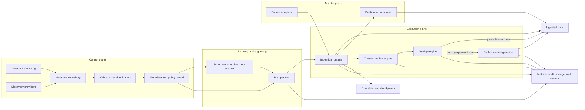
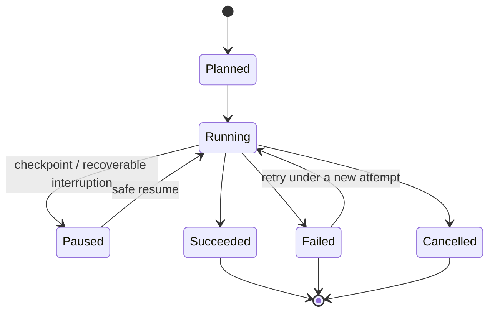

# Mimir System Architecture

## Status

**Accepted architectural baseline for initial implementation.**

Mimir is currently at the architecture-definition stage. This document selects
the architecture the initial implementation should follow. It describes
decisions and intended responsibilities, not features that already exist.
Technology selections made within adapters do not change this architecture.

## Context

Mimir is intended to manage metadata, ingestion, transformation, data quality,
and optional cleaning without binding its core model to a database, cloud,
orchestration engine, messaging system, data format, or transformation
language. The project must still provide versioned, recoverable, observable
execution and allow source and destination technologies to be replaced.

The architecture therefore needs to:

- keep business meaning and execution policy in a platform-independent model;
- activate only validated, versioned metadata;
- let scheduling trigger execution without owning ingestion logic;
- support recoverable and replayable ingestion;
- distinguish data-quality detection from data mutation;
- preserve provenance and audit evidence across every operation;
- isolate secrets and platform APIs in adapters.

## Decision

Mimir will use a **contract-first, modular architecture with separate control
and execution planes**.

The core will own domain types, metadata validation, planning, and execution
semantics. Platform and technology integrations will be capabilities behind
explicit ports. A dependency rule applies across all modules:

> Core domain and orchestration logic may depend on contracts, never on adapter
> implementations or platform-specific APIs.

The selected logical structure is:

The diagram shows logical boundaries. A deployment may initially place several
components in one process. Logical separation must remain in package
boundaries and dependency direction so these components can later be deployed
independently.

## Architectural Building Blocks

### Domain Contracts

The domain model is the shared language of Mimir. At minimum, it represents:

| Contract | Responsibility |
| --- | --- |
| Source | Connection reference, capabilities, defaults, and governance |
| Object | A table, file, endpoint, topic, or equivalent source unit |
| Column | A field, technical constraints, classification, and policies |
| Mapping | A technical-to-canonical conversion |
| Schedule | Trigger, dependency, retry, concurrency, and scope policy |
| Rule | Transformation, validation, cleaning, or policy behavior |
| Metadata Revision | An immutable, validated candidate or active version |
| Run | An immutable execution attempt |
| Checkpoint | A validated point from which work may safely resume |
| Lineage Record | Inputs, operations, versions, and resulting outputs |

Configuration inherits from source to object to column. More-specific
overrides are resolved during validation or planning and recorded in the
resulting immutable run plan.

### Control Plane

The control plane owns metadata and policy. It provides:

1. discovery and authoring of candidate metadata;
2. structural, semantic, compatibility, and security validation;
3. versioning and promotion of immutable metadata revisions;
4. resolution of inheritance and effective policy;
5. publication of active revisions;
6. an audit record for author, validation, activation, and supersession.

Draft metadata has no execution authority. A revision becomes active only after
validation succeeds. Runs pin a specific metadata revision; later metadata
changes must not mutate work already planned or running.

The metadata repository port hides persistence technology. Discovery,
authoring, and repository implementations remain replaceable.

### Scheduling and Planning

Scheduling evaluates metadata-defined triggers and dependencies. It may run
inside Mimir or through an external orchestrator, but it does not implement
ingestion algorithms.

Scheduling produces an execution request. A run planner then:

1. resolves the pinned metadata revision and effective scope;
2. loads declared source and destination capabilities;
3. chooses a supported load, checkpoint, and commit strategy;
4. rejects unsupported or unsafe combinations explicitly;
5. produces an immutable run plan;
6. records enough identity and parameters for deterministic replay.

An orchestrator owns trigger delivery and retries of execution requests. Mimir
owns retries of in-flight data work only when a run checkpoint and destination
commit strategy make that retry safe.

### Execution Plane

The execution runtime consumes an approved run plan. It coordinates ingestion,
transformation, quality evaluation, cleaning, and publication without knowing
about a particular storage or cloud implementation.

The execution boundary has four ordered stages:

1. **Ingest** — read source values and preserve required raw values and
   source-side provenance.
2. **Normalize and transform** — produce source-agnostic and canonical
   representations using explicitly ordered, versioned rules.
3. **Evaluate quality** — detect and report invalid or anomalous data without
   changing the input solely because it failed a check.
4. **Resolve invalid data and publish** — quarantine, mark, or reject data by
   policy, applying cleaning only through an approved rule.

Raw preservation, stage boundaries, and output commitments are determined by
the run plan. Transformation or cleaning must not be inferred from descriptive
metadata alone.

### Adapter Ports

The initial extension points are:

- metadata repositories;
- metadata discovery providers;
- source adapters;
- destination adapters;
- schedulers and orchestrators;
- transformation engines;
- quality-rule engines;
- state and checkpoint stores;
- metric, trace, audit, and event stores;
- secret reference resolvers.

Every adapter declares its capabilities and constraints. The planner selects a
valid combination rather than attempting a feature generically and masking an
unsupported operation. Adapters are responsible for translating domain
operations to their platform APIs and mapping platform failures to stable
Mimir failure categories.

Adapter contract tests are required so alternative implementations can be
substituted without changing core behavior. A conforming adapter may support a
subset of the full contract, provided that omitted capabilities are declared.

### State, Data, and Audit Stores

Mimir maintains three logically separate kinds of persistence:

| Concern | Contents | Retention and authority |
| --- | --- | --- |
| Metadata | Draft, validated, active, and retired revisions | Control-plane authority |
| Execution state | Run identity, plan, checkpoints, attempts, status, and failure | Execution-plane authority |
| Ingested data | Raw, normalized, cleaned, quarantined, and published records | Destination authority governed by metadata |

Observability and audit records may use another implementation port, but they
must correlate with metadata revision, run, stage, operation, and record-level
identity where applicable. Execution state is never inferred from the
destination's data contents alone.

## Core Execution Semantics

### Run Lifecycle

Every run plan is identified by an immutable run-plan version, metadata
revision, source scope, load strategy, and destination contract. A run has
explicit states:

Retries create a new attempt under the same logical run or a replay run, rather
than erasing previous evidence. A replay records both the original and replayed
execution identities and the reason for replay.

### Idempotency and Recovery

Mimir requires safe recovery, but it does not assume that every destination
provides exactly-once semantics. The planner must establish one of these
strategies:

- resume from a source and destination checkpoint using atomic acknowledgement;
- commit idempotent operations with stable record or batch identities;
- publish through a destination-provided transactional or deduplication
  mechanism;
- reject a run when no safe strategy can meet the declared delivery behavior.

Checkpoints are committed only after the corresponding data commitment is
known to be durable. A replay must be able to demonstrate which work is already
committed and which work remains eligible.

### Deterministic Replay

Replay must pin:

- metadata revision;
- source scope and, where supported, source position or snapshot;
- adapter and engine contract versions;
- rule ordering and rule versions;
- secret references, without recording secret values;
- relevant environment-independent parameters.

If the source cannot provide the required stable snapshot or position,
deterministic replay must be declared unavailable rather than presented as
guaranteed.

### Schema Drift

Adapters report observed schemas in a normalized contract. Discovered drift is
compared with the active metadata revision:

1. classify the difference and affected scope;
2. record the proposed metadata change and its provenance;
3. validate compatibility and downstream impact;
4. hold, reject, quarantine, or continue according to explicit policy;
5. activate new metadata only after a review and activation step required by
   policy.

Schema discovery cannot silently rewrite active metadata or silently broaden
the accepted data contract.

### Quality and Cleaning

Quality evaluation and cleaning are separate operations. A failed quality rule
produces a result, classification, and configured disposition. Possible
outcomes include rejection, quarantine, warning, and explicit cleanup.

A cleaning operation must identify the failed rule, correction rule, input
value or secure reference to it, output value, actor, metadata revision, and
result. Invalid data is never silently corrected. Cleaning is idempotent and
must preserve enough history to explain why a value changed.

## Security and Governance

The following are architectural requirements:

- Metadata stores secret references, never resolved secret values.
- Secret resolvers are selected by reference type and operate with least
  privilege.
- Source, object, column, and rule access is evaluated during authoring,
  planning, and runtime operation; it is not delegated only to a UI.
- Data classification can constrain destinations, transformations, cleaning,
  observability payloads, and retention.
- Logs and lineage avoid raw sensitive values unless a validated policy
  explicitly permits and protects them.
- Adapter credentials have the narrowest possible scope and lifetime.
- Activation, cleaning, credential-resolution, and access-policy decisions
  produce audit events.

## Failure Model

Failures are categorized at contract boundaries so orchestration and policy
remain technology-neutral. At minimum, categories cover:

- invalid metadata or run plan;
- unsupported adapter capability;
- authentication or authorization;
- configuration or secret-resolution failure;
- source or destination availability;
- incompatible schema or data contract;
- transformation or quality-rule failure;
- non-idempotent or ambiguous commit;
- exhausted retry or dependency policy;
- internal invariant violation.

Each failure records its category, stage, affected scope, retryability,
underlying adapter error reference, and whether a committed result may exist.
An ambiguous commit is not automatically retried. It requires reconciliation or
an explicitly safe retry strategy.

## Observability

Structured logs, metrics, traces, and audit events must correlate through:

- metadata revision;
- run-plan identifier;
- run and attempt identifiers;
- source, destination, object, and stage;
- rule or adapter contract version where applicable.

Operational telemetry may be sampled or retained independently from audit
records. Audit records used for lineage, activation, access, or cleaning must
not be dropped merely because operational sampling is enabled.

## Dependency Rules

The implementation must enforce these boundaries:

- Domain types depend on no infrastructure package or adapter.
- Use cases and planners depend on ports, not port implementations.
- Adapters depend on ports and domain types; the core does not depend on them.
- The execution runtime does not read or mutate draft metadata.
- A scheduler may request a run but cannot define execution state transitions.
- Quality evaluation does not call cleaning implicitly.
- Transformation and cleaning rules do not access platform clients directly.
- State persistence is separate from ingested-data persistence.

These rules should be checked through automated dependency and contract tests.

## Initial Delivery Shape

The first working implementation should be deployable as one process while
retaining the boundaries above. It should be introduced in this order:

1. domain types, metadata format, error model, and versioned contracts;
2. metadata validation, repository port, activation, and audit;
3. minimal in-process scheduler, run planner, and state store;
4. source and destination capability ports plus reference adapters;
5. run attempts, checkpoints, idempotent commit strategies, and replay;
6. ordered normalization and transformation;
7. quality results, quarantine, and explicit cleaning;
8. external scheduling, persistence, and observability adapters.

This sequence proves the dependency direction and recovery model before adding
technology-specific integrations.

## Consequences

### Benefits

- Core behavior is testable without platform infrastructure.
- Adapters and infrastructure can evolve independently.
- Metadata is validated and pinned before execution.
- Control-plane changes cannot silently alter active runs.
- Recovery and replay have explicit, inspectable requirements.
- Quality detection remains separate from data correction.
- A single-process initial implementation can later split into services without
  replacing domain contracts.

### Costs and Constraints

- The project needs stable contracts, versioning rules, and contract tests
  before feature-rich integrations.
- Adapter capabilities must be modeled explicitly; generic behavior cannot be
  assumed from a common interface name.
- Reconciliation and recovery are more complicated than retrying whole jobs.
- Keeping state, metadata, audit, and data logically separate adds
  coordination and consistency requirements.
- One-process deployment does not remove the need to maintain module
  dependency boundaries.

## Open Decisions

This architecture intentionally leaves technology and detailed protocol
choices open. They must be resolved through separate records before
implementation of the affected part:

- the concrete language, package model, and metadata serialization;
- the version-compatibility policy and migration mechanism;
- the canonical domain type system and binary or streaming record contract;
- checkpoint granularity and the supported commit strategies;
- the event and command envelope for an independently deployed execution
  plane;
- retention and access-control policies for each data class;
- the minimum reference-adapter set for the first release;
- how activation approval is represented and enforced;
- service-level expectations for freshness, latency, and recovery.

Selecting those details must preserve the dependency rules and invariants in
this document.

## Architecture Invariants

The following statements are normative:

1. Only validated, activated metadata can authorize a new run.
2. Every run pins an immutable metadata revision and immutable plan.
3. Adapters declare capabilities and failures; the core never probes hidden
   platform behavior as a substitute for a capability contract.
4. Execution state and ingested data are logically distinct.
5. A checkpoint is valid only when resume from it is demonstrably safe.
6. Ambiguous commits are reconciled, not blindly retried.
7. Replays state their guarantees and record their inputs and versions.
8. Quality evaluation does not mutate data.
9. Cleaning is explicit, deterministic, approved, and auditable.
10. Secrets are references in metadata and are not emitted into plans, logs,
    lineage, or audit records.
