# Change Implementation Standard

## Status

**Required workflow for every change to Mimir.**

This document defines the work that must accompany a change, regardless of
whether it modifies code, tests, contracts, configuration, infrastructure, or
documentation. The workflow applies from backlog creation through production
promotion.

Commands, task names, repository templates, and automation described here are
requirements for the implementation, not claims that those capabilities
already exist. Until they are implemented, contributors must perform the
equivalent checks explicitly and record the evidence in the change.

## Change Principles

Every change must be:

- traceable to an approved outcome or defect;
- small enough to review and validate independently;
- implemented with tests that demonstrate the required behavior;
- compatible with the documented architecture unless an architecture decision
  explicitly changes it;
- observable, recoverable, and safe to deploy;
- documented for users, operators, and developers;
- free of unrelated refactoring.

No change is complete merely because it compiles or its author tested it.

## Required Lifecycle

```mermaid
flowchart LR
    Backlog["Backlog and scope"]
    Design["Impact and design review"]
    Tests["Write failing tests"]
    Implement["Implement and refactor"]
    Verify["Verify locally and in CI"]
    Acceptance["Acceptance verification"]
    Document["Documentation and release notes"]
    Review["Independent review"]
    Merge["Merge and promote"]
    Observe["Monitor and close"]

    Backlog --> Design --> Tests --> Implement --> Verify
    Verify --> Document --> Review --> Acceptance --> Merge --> Observe
    Implement --> Tests
```



Documentation, test updates, and architecture impact analysis begin with
implementation rather than at the end. A return to an earlier stage is expected
when tests or review reveal a requirement change.

## 1. Backlog Management

Every change must have a backlog item with:

- a unique issue or work-item identifier;
- a concise problem statement and intended user or operator outcome;
- explicit scope and out-of-scope behavior;
- acceptance criteria written as observable outcomes;
- affected modules, contracts, environments, and data classes;
- dependencies and blocking decisions;
- expected compatibility, migration, and rollback impact;
- links to relevant architecture decisions or documents;
- priority, owner, and target milestone when applicable.

Backlog items must be refined before implementation. A proposed implementation
that changes scope, platform boundaries, or acceptance criteria requires the
item to be updated before the work continues.

Use these work-item types:

| Type | Use |
| --- | --- |
| Feature | Adds an intended user or system capability |
| Defect | Restores documented or accepted behavior |
| Technical enabler | Introduces a contract, test facility, or infrastructure needed for later behavior |
| Architecture decision | Resolves a cross-module design question |
| Maintenance | Upgrades, secures, or simplifies behavior without changing intended outcomes |
| Documentation | Corrects or adds user, operator, or contributor guidance |
| Incident follow-up | Prevents recurrence and verifies recovery or observability gaps |

An incident follow-up is not closed until its corrective and preventive actions
are either completed or explicitly tracked as linked backlog items.

### Backlog State

An item normally moves through:

```text
Proposed -> Refined -> Ready -> In Progress -> Review ->
Acceptance -> Done -> Closed
```

`Done` means the change satisfies its acceptance criteria and Definition of
Done. `Closed` means it has been promoted or otherwise verified in the intended
environment, with follow-up work linked.

Blocked work records the blocker, owner, and next decision. Items must not
remain in `In Progress` when work has stopped.

## 2. Impact and Architecture Review

Before implementation, identify the affected:

- domain contracts and versioned capabilities;
- metadata, run plan, checkpoint, and lineage models;
- application use cases and entrypoints;
- source, destination, discovery, repository, scheduler, quality, and
  transformation ports;
- adapter behavior and technology-specific integrations;
- state transitions, idempotency, recovery, and deterministic replay;
- security boundaries, secrets, authorization, and data classification;
- environments, deployment configuration, and operational procedures;
- public API, CLI, metadata schema, and file-format compatibility.

If the change affects a documented architecture boundary, the author must
update the relevant architecture document or propose an Architecture Decision
Record (ADR). The ADR must state context, decision, consequences, status, and
alternatives considered. An unresolved platform decision remains explicitly
open rather than being embedded in implementation.

Architecture changes must preserve:

- domain independence from platform adapters;
- validated metadata before activation;
- orchestration separate from execution logic;
- run state separate from ingested data;
- declared adapter capabilities;
- safe checkpoint and commit ordering;
- quality detection separate from cleaning;
- auditable, explicit data mutation.

## 3. Test-Driven Development

Behavioral changes use test-driven development (TDD):

1. add a test that expresses the intended outcome;
2. run the smallest relevant test and observe the expected failure;
3. implement the minimum behavior that satisfies the test;
4. refactor without changing the behavior;
5. rerun the focused test, then the affected broader suite.

A failing test must fail for the intended reason. Do not mask it by changing
multiple behaviors, weakening assertions, skipping the test, or adding broad
retries.

### Required Tests by Change Type

| Change | Minimum tests |
| --- | --- |
| Domain rule | Unit test covering valid, invalid, and boundary behavior |
| Use case | Application test with controlled port doubles |
| Adapter | Shared port contract suite plus adapter-specific integration tests |
| Public API or CLI | Contract, serialization, validation, authorization, and error tests |
| Schema or metadata change | Valid, invalid, unknown-field, version, and migration/compatibility fixtures |
| State or run transition | State-machine, duplicate-delivery, stale-worker, and recovery tests |
| Checkpoint or destination commit | Crash/fault tests before and after each durable boundary |
| Transformation or cleaning | Determinism, versioning, provenance, idempotency, and audit tests |
| Quality rule or disposition | Pass, fail, quarantine, reject, and explicit-cleaning tests |
| Scheduling or concurrency | Dependency, cancellation, timeout, lease/fencing, and shutdown tests |
| Security change | Denied access, least privilege, secret redaction, and audit tests |
| Documentation or configuration only | Relevant lint, link, schema, generation, or deployment validation |

Tests must not depend on ambient credentials or a developer's local machine.
Network-dependent and deployed-environment tests are explicit integration or
acceptance suites. Synthetic test data is the default.

### Regression and Compatibility Tests

Every defect fix includes a test that fails without the fix. Changes to a public
contract, metadata model, adapter port, persisted state, or wire format must
include a compatibility test for:

- the currently supported previous version;
- forward- or backward-compatible behavior, if claimed;
- migration and rollback where state is involved;
- rejection of an unsupported version without partial side effects.

Tests verify behavior and observable state, not private implementation
details.

## 4. Implementation

Implementation must follow the
[software architecture](../architecture/software-architecture.md) and the
[technology and delivery baseline](../software/technology-and-delivery.md).

Contributors must:

- depend inward through ports rather than directly on infrastructure;
- keep entrypoints free of business transitions;
- make domain and run-plan state immutable after activation or approval;
- use explicit context, cancellation, timeout, and error behavior;
- map adapter failures to Mimir's stable error categories;
- preserve correlation across logs, metrics, traces, audit, and lineage;
- reject unsupported adapter capabilities explicitly;
- keep secrets as references and prevent them from entering plans and outputs;
- avoid silently correcting invalid data;
- preserve safe retry and reconciliation behavior;
- avoid unrelated refactoring in a behavior change.

Concurrent code must have deterministic cancellation and an explicit ownership
or fencing mechanism. Cleanup must cover successful, failed, and interrupted
paths.

### Changes with Data Impact

Any change to metadata, execution state, data records, lineage, or audit must
state:

- schema and version impact;
- ownership of the data;
- retention and classification impact;
- read and write compatibility;
- migration sequence and failure handling;
- rollback limitations;
- whether existing runs can continue after deployment;
- how provenance is retained across migration.

Destructive migration requires a separately approved plan. A deploy must not
rely on an irreversible migration being safe because a rollback is
unavailable.

## 5. Documentation

Documentation is part of the implementation. A change is not ready for review
until relevant documentation is updated in the same change set or a linked
backlog item is explicitly approved for a later release.

### Functional Documentation

For a user- or operator-visible capability, functional documentation must
describe:

- purpose and intended users;
- prerequisites and permissions;
- supported inputs, configuration, and constraints;
- expected state transitions and outputs;
- quality, cleaning, quarantine, and rejection behavior;
- examples using synthetic data;
- failure conditions, retry behavior, and recovery instructions;
- observable audit, metric, trace, and lineage behavior;
- compatibility guarantees and limitations;
- links to the relevant metadata schema, API, or CLI contract.

Documentation must distinguish:

- behavior that exists now;
- intended behavior not yet implemented;
- optional behavior supplied by an adapter;
- proposed behavior subject to a decision.

Examples must be executable or validated where practical.

### Installation Documentation

Installation documentation must cover every supported target and, as
applicable, include:

- supported operating systems, architectures, runtimes, and versions;
- required dependencies and optional capabilities;
- acquisition and integrity verification of release artifacts;
- clean installation and upgrade steps;
- required configuration and environment-specific values;
- non-secret configuration examples and secret-reference setup;
- permission and least-privilege requirements;
- validation and health checks;
- local test and acceptance setup;
- upgrade, migration, rollback, backup, and uninstall procedures;
- troubleshooting for observable, non-sensitive failure conditions.

Installation instructions must be tested from a clean environment for a
supported target before release. They must not require contributors to fetch
an undocumented global tool or use production credentials.

### Architecture and Software Documentation

Changes to responsibilities, dependency direction, deployment boundaries,
data ownership, contracts, or cross-module behavior require updates to the
architecture and software documents. Material decisions require an ADR rather
than silently rewriting established decisions.

### Operations and Release Documentation

Changes affecting deployment or runtime operations must document:

- configuration and required capability changes;
- health, readiness, and observability impact;
- data or contract migration;
- deployment order and compatibility window;
- rollback and forward-recovery procedure;
- smoke and acceptance checks;
- alert, runbook, capacity, and retention impact;
- release notes and known limitations.

### Documentation Quality

All affected links, Mermaid diagrams, schemas, command examples, and generated
references must be checked. Documentation must avoid credentials, private
endpoints, personal data, or production payloads.

## 6. Agent Usage

AI and automation agents may assist implementation, review, testing, and
documentation, but remain tools operating under human accountability.

### When to Use Agents

Agents may be used for:

- repository and architecture exploration;
- focused implementation and refactoring;
- test generation after requirements are understood;
- architecture, security, accessibility, or performance review;
- failure-trace analysis and verification;
- documentation consistency checks;
- repetitive, reviewable transformations.

Use a specialized agent only when the available task benefits from its
specialized context. Mimir architecture-documentation changes must be checked
against the Mimir Architect instructions in
[`mimir-architect.agent.md`](../../.github/agents/mimir-architect.agent.md).

### Agent Guardrails

An agent must:

- receive the backlog item, acceptance criteria, and relevant boundaries;
- inspect current repository evidence before changing files;
- preserve unrelated work;
- separate established facts, proposals, and unresolved decisions;
- avoid selecting an unapproved database, cloud, orchestrator, or proprietary
  protocol on behalf of the project;
- run only authorized, relevant, non-destructive commands;
- not expose source, credentials, or private data to unapproved external
  systems;
- not create, approve, or deploy a release without required human approval;
- not claim a test or check passed unless its output demonstrates that result;
- report unresolved uncertainty, blocked checks, and assumptions.

### Review of Agent Output

A human reviewer is responsible for:

- validating agent-generated evidence against the repository and observed
  runtime behavior;
- checking that generated tests assert requirements rather than implementation;
- reviewing dependency, security, migration, and architecture impact;
- checking documentation for unimplemented claims;
- confirming that no unrelated work was changed;
- confirming every automated action and deployment promotion.

Agent output must not bypass code review, protected-branch rules, security
review, acceptance criteria, or release approval.

## 7. Security, Privacy, and Compliance

Every change must evaluate:

- authentication and authorization boundaries;
- secret acquisition, storage, logging, and lifetime;
- data classification and destination policy;
- untrusted input validation and resource limits;
- dependency and supply-chain risk;
- audit requirements for activation, access, cleaning, and ambiguous commits;
- deletion, retention, and backup behavior;
- generated artifacts and SBOM/provenance requirements.

Changes handling secrets, identity, authorization, external adapters,
cleaning, or security-sensitive data require focused security review.

Security failures must be explicit. A change must not turn a policy denial,
unavailable secret, unsupported capability, or ambiguous commit into
success-shaped behavior.

## 8. Verification and CI/CD

Before review, run the smallest checks that cover the change and then the
required broader checks:

1. formatting and generated-artifact checks;
2. focused tests demonstrating the changed behavior;
3. package, module, or dependency checks;
4. architecture dependency and contract checks;
5. lint, vet, and vulnerability checks;
6. the affected unit, contract, integration, or acceptance suites;
7. documentation and schema/link validation.

Required CI status must distinguish:

- passed;
- failed;
- not applicable because the check's affected scope is absent;
- blocked by an explicit external condition.

A check must not be silently skipped. Production never uses an artifact that
was rebuilt after test, acceptance, or review.

Deployment changes must use the test-to-acceptance-to-production promotion
model and preserve rollback evidence described in the
[technology and delivery baseline](../software/technology-and-delivery.md).

## 9. Review and Acceptance

The author supplies:

- the backlog item and acceptance criteria;
- summary of behavior and architecture impact;
- test evidence and failing-test rationale for defect fixes;
- migration, compatibility, rollback, and security notes;
- updated functional, installation, operation, and release documentation;
- evidence of agent usage and human review when an agent assisted;
- known limitations and follow-up items.

Reviewers independently verify:

- correctness and architecture conformance;
- requirement and test coverage;
- failure, recovery, replay, and concurrency behavior;
- adapter substitutability and contract compatibility;
- secrets, access control, data classification, and auditability;
- documentation accuracy;
- installation and deployment implications.

Acceptance verifies observable criteria against the candidate artifact in the
intended environment. It is separate from code review and from the author's
local validation.

## Definition of Done

A change is Done only when all applicable conditions are met:

- the backlog item is refined and linked;
- acceptance criteria are satisfied;
- the change follows TDD and a regression test covers every fixed defect;
- unit, contract, integration, and acceptance results are recorded as
  applicable;
- architecture and dependency boundaries remain valid;
- compatibility, migration, recovery, and rollback are addressed;
- functional, installation, and operational documentation is current;
- security, data classification, observability, and audit impact are reviewed;
- generated artifacts are current and CI checks pass;
- an independent reviewer approves the change;
- the exact promoted artifact is identifiable;
- follow-up work is linked rather than hidden in a successful close.

## Exception Policy

Any skipped requirement needs an explicit, reviewable exception in the change
record. The exception states:

- skipped requirement and reason;
- risk and affected scope;
- compensating control;
- owner and expiration;
- linked follow-up backlog item.

Documentation-only changes may skip unrelated runtime checks only when the
documentation, links, diagrams, schemas, and generated examples pass their
relevant validation. Emergency production fixes may accelerate the delivery
sequence, but do not waive regression testing, security review, audit evidence,
or retrospective follow-up.
