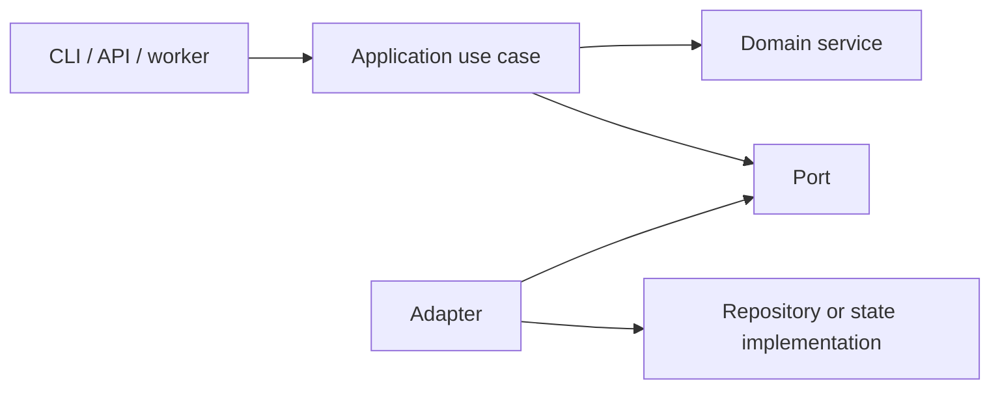

# Programming Languages, Tools, and Delivery

## Status

**Accepted initial technology baseline for the
[software architecture](../architecture/software-architecture.md), as scoped
by [ADR-0001](../architecture/decisions/ADR-0001-foundation-and-contracts.md)
and [ADR-0002](../architecture/decisions/ADR-0002-local-reference-profile.md).**
The first local implementation is smaller than the complete target described
below; absent capabilities are explicitly not applicable or blocked, not
silently treated as implemented.

The system remains independent of a particular database, cloud, messaging
product, workflow engine, data format, or orchestration platform. Decisions in
this document select implementation languages and development tools, plus the
initial transport and test conventions, but do not select those infrastructure
products.

## Technology Decision

Mimir will use:

- **Go** as the implementation language for domain, application, runtime,
  reference adapters, command-line entrypoints, APIs, and workers;
- Go domain types for in-process interaction, with **JSON** metadata and
  configuration contracts and **YAML** as a human authoring convenience;
- **JSON Schema** for metadata and configuration validation;
- **OpenAPI 3.1** for synchronous HTTP contracts;
- **OpenTelemetry** interfaces for logs, metrics, and traces;
- direct, typed Go calls between modules in the initial process;
- HTTP/JSON and scheduler/orchestrator adapter contracts at process boundaries;
- **GitHub Actions** for continuous integration and delivery;
- OCI container images and release archives as deployable artifacts.

Go is selected because it supports a single cross-platform toolchain, static
binaries, explicit interfaces, structured concurrency, strong testing tools,
and a small operational runtime. These characteristics fit Mimir's
contract-first modular design and reference-adapter model without requiring
dynamic plugin loading or a language-specific application server.

Other languages may be used by an external transformation, quality, or source
integration only behind a versioned adapter contract. They must not become
dependencies of the domain or application modules.

### Accepted first-release baseline

The initial implementation uses Go 1.27.3, a single Go module, and a pinned
Draft 2020-12 JSON Schema validator as its only non-standard-library runtime
dependency. The validator and metadata schema are embedded in the binary.
Repository checks use Python 3.12's standard library and `make` tasks. Metadata
uses JSON v1 and records use JSON-object contracts. The
supported build targets are Linux, macOS, and Windows on amd64 and arm64; only
Linux/amd64 has been exercised as a runtime environment so far. The local
reference profile is single-process and local-disk only. This does not select a
production persistence, secret, identity, registry, signing, or deployment
product.

## Module Technology Map

| Module | Implementation language | Formats and tools | Primary interaction style | Test approach |
| --- | --- | --- | --- | --- |
| Domain contracts | Go | Standard library, versioned Go interfaces | Direct Go types and pure function calls | Table-driven unit, invariant, property-based, and compatibility tests |
| Metadata domain and policy | Go | JSON Schema, YAML-to-JSON conversion | Direct calls from application services | Unit tests and schema fixtures |
| Metadata authoring/discovery/validation/activation | Go | JSON Schema validators, Go repository ports | Use-case calls through ports | Application tests with in-memory repositories; adapter contract tests |
| Planning and capability matching | Go | Versioned capability models | Direct Go calls | Unit tests for compatibility and delivery guarantees |
| Scheduler adapter | Go | Scheduler port, HTTP/JSON at an external boundary when required | Dispatches plan requests; never calls execution internals directly | Fake scheduler tests and end-to-end trigger contract tests |
| Run and attempt state | Go | State-store port | Direct calls from the runtime coordinator | State-machine, race, fencing, and crash-recovery tests |
| Ingestion runtime | Go | Context, bounded goroutines, OpenTelemetry | In-process stage commands and typed results | Deterministic fake adapters, fault injection, recovery tests |
| Transformation engine | Go rules and reference engine | Versioned rule identifiers, canonical JSON records | Engine port called by an execution stage | Golden tests, determinism tests, rule-version tests |
| Quality engine | Go | Versioned rule contract and result model | Engine port called independently of cleaning | Rule fixtures, false-positive/negative, disposition, and determinism tests |
| Cleaning engine | Go | Explicit cleaning-plan and audit model | Called only from an approved publication decision | Preview/apply, idempotency, and audit correlation tests |
| Source adapters | Go | Go source port and versioned capability declaration | Streamed domain records or bounded batches | Shared adapter contract suite and technology-specific integration tests |
| Destination adapters | Go | Go destination port and versioned capability declaration | Idempotent writes, commit evidence, and reconciliation | Shared adapter contract suite, duplicate-write, and ambiguous-commit tests |
| Metadata/state repositories | Go adapters | Persistence ports; storage format owned by each adapter | Repository and conditional-transition methods | Shared repository contract suite; backend-specific integration tests |
| Secret resolvers | Go adapters | Opaque secret-reference model | Short-lived, scoped infrastructure call | Redaction tests, denied-reference tests, and adapter tests |
| Observability adapters | Go | OpenTelemetry logs, metrics, and traces | Context propagation and asynchronous export where available | Attribute, redaction, correlation, and export-failure tests |
| HTTP API | Go | OpenAPI 3.1, HTTP/JSON | Synchronous commands and operational queries | Handler tests, contract tests, authorization tests |
| CLI | Go | Standard `flag` package or a small replaceable command library | Calls the same application services as other entrypoints | Command, output, and exit-code tests |
| Worker entrypoint | Go | OpenAPI-described control requests or direct scheduler adapter delivery | Owns run attempts; calls the execution coordinator | Queue/trigger fakes, graceful-shutdown, and lease/fencing tests |
| Documentation | Markdown, Mermaid | Markdown links and diagrams | Reviewed with code and architecture changes | Link and format checks |

## Interaction Model

### Within a Process

The initial deployment is a modular monolith. Modules interact through typed
Go interfaces and immutable domain values:



The runtime composition selects adapters and injects implementations into
their ports. Entry-points must not construct repositories, source clients, or
destination clients inside use cases.

There is no Go plugin discovery in the initial implementation. Reference and
built-in adapters are compiled into an explicit registry. This avoids
platform-dependent plugin behavior and makes the shipped capability set
deterministic. External adapters can be added later through a process or HTTP
contract without changing domain interfaces.

### Across Processes

Cross-process interaction is deliberately thin:

| Boundary | Contract | Semantics |
| --- | --- | --- |
| User or integration to API | OpenAPI 3.1 over HTTP/JSON | Synchronous commands and queries; stable versioned errors |
| Scheduler/orchestrator to Mimir | Scheduler-adapter request over HTTP/JSON or in-process call | At-least-once delivery with stable request and run identities |
| Worker-to-worker coordination | State store conditional transition and fencing | No custom peer-to-peer protocol |
| Runtime to external adapter host | Future versioned HTTP/JSON adapter protocol | Declared capabilities, bounded payloads, cancellation, and timeout requirements |
| Telemetry export | OpenTelemetry SDK/exporter boundary | Correlation and redaction; exporter failure must not change domain outcomes |

The initial architecture does not introduce an internal event bus or RPC
service mesh. A future deployment can add an orchestrator or messaging adapter
when scale requires it without changing the application contracts.

HTTP resources and messages carry contract version, correlation identifiers,
metadata revision, run identity, and attempt identity where applicable. Secret
values are excluded.

### Record and Metadata Representation

In memory, modules use Go domain types rather than untyped maps. Metadata and
configuration have versioned JSON contracts; YAML accepted at an authoring
boundary is converted to canonical JSON and validated before storage.
Conversions must reject duplicate keys and unknown fields unless an explicit
versioned compatibility rule permits them.

Bulk or streaming records may use an adapter-owned transfer format internally,
but the adapter must present the canonical domain record and provenance
contract to the core. The binary or streaming record representation remains an
open decision; it does not require destinations to store JSON.

## Repository and Build Layout

The repository will be organized as a Go workspace or module, depending on
the eventual number of independently releasable binaries. The initial default
is one Go module:

```text
cmd/
  mimir/
  mimir-worker/
internal/
  domain/
  application/
  ports/
  metadata/
  planning/
  execution/
  state/
  adapters/
  entrypoints/
  observability/
contracts/
  metadata/
  openapi/
  examples/
pkg/
  contracttest/
test/
  integration/
  acceptance/
deploy/
  local/
  ci/
```

The `internal` tree enforces implementation ownership. `pkg/contracttest` is
the intentional public test surface used to verify external adapter
conformance. Infrastructure-specific executable entrypoints live under
`cmd`.

No package under `domain`, `application`, or `ports` may import a package under
`adapters`, `entrypoints`, or deployment infrastructure. Composition is
performed in `cmd` or `internal/entrypoints`.

## Development Toolchain

The following tools are required for local development and CI:

| Tool | Purpose |
| --- | --- |
| Supported Go toolchain | Build, format, vet, test, race detection, and module management |
| `gofmt` | Canonical source formatting |
| `go vet` | Standard static checks |
| `golangci-lint` or an equivalent configured linter set | Project lint and dependency rules |
| `staticcheck` | Additional correctness checks |
| `govulncheck` | Dependency vulnerability checks |
| `go test` | Unit, contract, integration, and acceptance runners |
| JSON Schema tooling | Validate schema examples and metadata fixtures |
| OpenAPI validation and generation tooling | Keep API definitions and handlers compatible |
| Docker-compatible container tooling | Reproducible local dependencies and release image construction |
| GitHub Actions | CI, artifact publication, promotion, and scheduled verification |

Tool versions are pinned in repository configuration. The CI result must be
reproducible from a fresh checkout by using those pins rather than globally
installed developer versions.

## Testing Strategy

### Test Classification

Tests are classified so the same commands can run locally and in automation:

| Class | Name convention or build constraint | External requirement | Default cadence |
| --- | --- | --- | --- |
| Unit | Normal Go tests | None | Every change |
| Contract | Normal Go tests plus reusable contract fixtures | Adapter implementation only | Every adapter change |
| Integration | `integration` build tag | Ephemeral test dependencies | Every pull request and test deployment |
| Acceptance | `acceptance` build tag | Deployed acceptance environment | Pre-production promotion |
| End-to-end production smoke | `production_smoke` build tag | Production endpoint with restricted scope | After production deployment |
| Dependency and architecture | Normal Go test or lint rule | Source tree | Every change |

The default `go test ./...` command must remain fast and hermetic. Tests needing
network, credentials, durable services, or a deployed environment require an
explicit build tag or command so they cannot pass or fail accidentally because
of an unavailable ambient system.

### Module and Contract Tests

Every infrastructure adapter must run:

- the shared port conformance suite;
- its capability declaration tests;
- translated error-category tests;
- cancellation and timeout tests;
- telemetry redaction tests;
- technology-specific integration tests.

Every execution path must have fault scenarios for interruption:

- before a destination write;
- after a write but before commit evidence;
- after commit but before state checkpoint;
- after checkpoint but before source acknowledgement;
- with an expired or stale worker lease;
- with duplicate input delivery;
- with changed capabilities or rule versions.

Tests assert externally observable state and deterministic replay evidence,
not private implementation details.

### Test Data

Test data is synthetic unless an explicitly approved, redacted, and minimized
production-derived fixture is needed. Fixtures must not contain production
secrets, personal data, or sensitive raw values.

Golden files are reviewed for canonical JSON formatting and must include
contract version and metadata revision where those affect output. Randomized
tests use a printed seed and must rerun deterministically.

## Local Development

Local development must provide the same dependency direction and configuration
shape as deployed environments, without requiring cloud accounts.

The intended local workflow is:

1. install the pinned Go toolchain and repository-pinned development tools;
2. create local configuration from a non-secret example;
3. provide secret references only when a configured adapter consumes them;
4. run unit and contract tests;
5. run the application as a single binary with local file adapters; schedule
   evaluation only persists requests and does not dispatch them;
6. run tagged local-profile integration tests; no external dependency is
   currently selected;
7. run lint, vet, and race tests before proposing a change.

Local reference adapters are deterministic and in-repository. The local
secret-resolver port accepts `env://NAME` in a synchronous callback with a
bounded context, but is not wired into the current file source/destination
composition. A production backend must not become a hidden prerequisite for
the default developer workflow.

Typical commands are standardized through version-controlled task definitions:

```text
make test        -> fast hermetic tests
make test-race   -> race-enabled core tests
make contract    -> shared adapter contract suites
make integration -> tagged local-profile integration suites
make lint        -> format, vet, architecture, and repository checks
make security    -> secret scan, module verification, vulnerability scan
make build       -> local binary (CI builds the six supported targets)
make package     -> deterministic local tar archive and identity manifest
make install-smoke -> temporary clean install, health, validation, and synthetic run
make generate-metadata-schema -> copy the canonical v1 schema into the Go embed location
make docs        -> metadata contract, examples, and link checks
```

The task runner is not allowed to embed implementation behavior; these tasks
must remain invocations of normal Go and validation tools. Local packages built
from a dirty working tree are labeled non-candidate and record the working-tree
status digest.

## Environments

### Environment Model

| Environment | Purpose | Data and credentials | Deployment mechanism | Required automation |
| --- | --- | --- | --- | --- |
| Local | Developer feedback and hermetic integration | Synthetic data; development secret resolver | Local binary or task command | Unit, contract, lint, and selected integration tests |
| Test | Automated, isolated pull-request and merge verification | Synthetic and generated data; short-lived test credentials | Ephemeral environment from the candidate artifact or build | Unit, contract, integration, API, recovery, vulnerability, and dependency checks |
| Acceptance | Business and operational sign-off against production-like policies | Controlled non-production data and independently managed secrets | Promotion of the immutable candidate artifact | Full integration, acceptance, migration/compatibility, load, and rollback tests |
| Production | Operational ingestion | Production-classified data and least-privilege secrets | Promotion of the accepted artifact, never a rebuild | Smoke, health, contract compatibility, audit, rollback, and post-deployment checks |

Acceptance configuration may approximate production topology, scale, and
security policy. It must not share production credentials or writable
production destinations.

### Configuration by Environment

The same code artifact is promoted through test, acceptance, and production.
Environment-specific values are externalized as configuration:

- adapter registrations and endpoint locations;
- opaque secret references;
- scheduling and worker limits;
- retention and classification policy;
- telemetry destinations and sampling;
- feature gates for non-default capabilities.

Environment configuration cannot enable a different domain implementation or
bypass metadata validation. Configuration is versioned, reviewed, and
validated at startup against the same schema. A production build must fail
closed when required configuration, capability, or secret references are
invalid.

## CI Pipeline

The current GitHub Actions workflow runs formatting, hermetic tests, vet,
architecture, documentation, contract, integration-scope, six cross-target
builds, and a pinned `govulncheck` scan; it builds a candidate artifact with
revision and binary digest. It does not sign, deploy, promote, or roll back.
The remainder of this section describes required target behavior, not
configured deployment capability.

Every pull request and merge runs the following sequence:

```mermaid
flowchart LR
    Checkout["Checkout and tool pins"]
    Restore["Restore Go and tool cache"]
    Contracts["Generate/check contracts"]
    Quality["Format, lint, vet, and dependency policy"]
    Unit["Unit, contract, and race tests"]
    Build["Build binaries and images"]
    Scan["Vulnerability and secret checks"]
    Int["Ephemeral integration tests"]
    Artifact["Sign and publish candidate artifacts"]
    TestDeploy["Deploy to isolated test environment"]
    Verify["Integration and recovery verification"]

    Checkout --> Restore --> Contracts --> Quality --> Unit --> Build --> Scan --> Int --> Artifact --> TestDeploy --> Verify
```



Required checks:

- formatting produces no diff;
- Go module files are tidy and dependency policy passes;
- lint and vet report no errors;
- unit and contract tests pass, including race tests for the core runtime;
- generated OpenAPI and contract outputs are current;
- architecture dependency rules pass;
- vulnerability and secret scans satisfy policy;
- release binaries build for supported operating systems and architectures;
- container image construction succeeds when applicable;
- ephemeral integration and recovery tests pass;
- the candidate artifact has a content digest and provenance record.

Expensive acceptance suites need not run on every documentation-only change,
but required pull-request status names must distinguish `not applicable` from
failure. No silent skip is allowed for an affected module.

## CD and Promotion

Continuous delivery promotes artifacts; it does not rebuild them for each
environment.

```mermaid
flowchart LR
    Candidate["Candidate artifact and provenance"]
    Test["Test deployment"]
    Acceptance["Acceptance deployment"]
    Approval["Approval and policy gate"]
    Production["Production deployment"]
    Observe["Automated smoke and observation"]
    Rollback["Rollback to prior artifact"]

    Candidate --> Test
    Test -->|"checks pass"| Acceptance
    Acceptance -->|"acceptance pass"| Approval
    Approval --> Production --> Observe
    Observe -->|"failed gate"| Rollback
```



Deployment gates include:

- accepted artifact digest and provenance;
- configuration and secret-reference validation;
- metadata compatibility and required migration status;
- acceptance results tied to the exact artifact digest;
- no unresolved critical security or contract-compatibility finding;
- operational capacity and rollback checks;
- approval policy for production.

Deployment automation records the artifact, configuration revision, metadata
revision, responsible actor or automation identity, start and end times, and
outcome. Production deployment first verifies health, restricted read
behavior, worker fencing, and telemetry correlation before enabling normal
traffic. A failed gate triggers rollback to the prior accepted artifact or a
documented forward fix.

## Deployment Compatibility

All deployed processes expose stable:

- health and readiness outcomes;
- build and artifact identity;
- supported contract versions;
- migration or minimum-state compatibility;
- graceful shutdown and bounded in-flight work.

Workers must stop accepting new attempts, finish or checkpoint bounded active
work, and release execution ownership during shutdown. A rolling deployment
therefore cannot create two active owners of the same run attempt.

Database, metadata format, and protocol migrations follow expand-and-contract
compatibility unless a separately approved migration requires downtime.
Backward compatibility is tested in CI and acceptance before an old version is
removed.

## Release and Version Policy

The release unit is an immutable application artifact plus its contract
definitions. The release process records:

- semantic artifact version;
- source revision and build identity;
- supported domain, metadata, HTTP, and adapter contract versions;
- checks and approvals executed against the artifact;
- known limitations and migration requirements.

Source and contract compatibility are independently versioned where practical.
A breaking core or metadata contract change requires an explicit migration and
compatibility window. Release automation must not overwrite an existing
artifact identity.

## Acceptance Criteria for the Initial Tooling

The technology baseline is established when:

1. a clean checkout can build Mimir with pinned tools;
2. `test`, `test:contract`, `lint`, and `build` work on supported developer
   operating systems;
3. the default test command is hermetic;
4. adapter contract tests are reusable outside the reference implementation;
5. generated API and metadata artifacts fail CI when stale;
6. CI can create a candidate artifact from any passing source revision;
7. the same candidate can be promoted to test, acceptance, and production;
8. environment configuration and secret references are validated without
   resolving secrets into logs or test output;
9. acceptance and production smoke automation identifies the exact artifact
   tested;
10. rollback can restore the prior accepted artifact without rebuilding it.

## Open Decisions

This document leaves the following product and infrastructure decisions open:

- the exact linter configuration;
- OpenAPI generation/validation tooling for a future API;
- the authorization protocol and identity provider;
- whether the initial API and worker are one or separate binaries;
- production-suitable metadata, state, and data persistence implementations;
- the container registry and signing/provenance platform;
- acceptance data provisioning and production smoke permissions;
- the deployment and rollback mechanism used by each hosted environment.

The remaining decisions should be captured in focused ADRs before the
affected delivery capability is implemented. They must preserve the module boundaries,
artifact promotion model, and platform-neutral contracts defined here.
